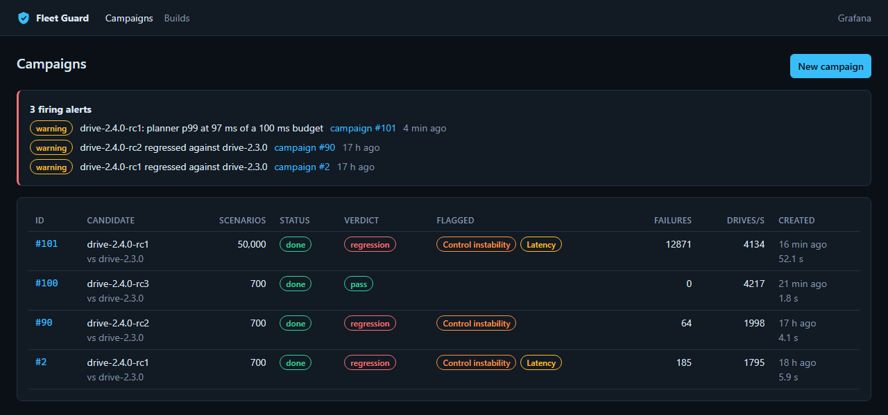
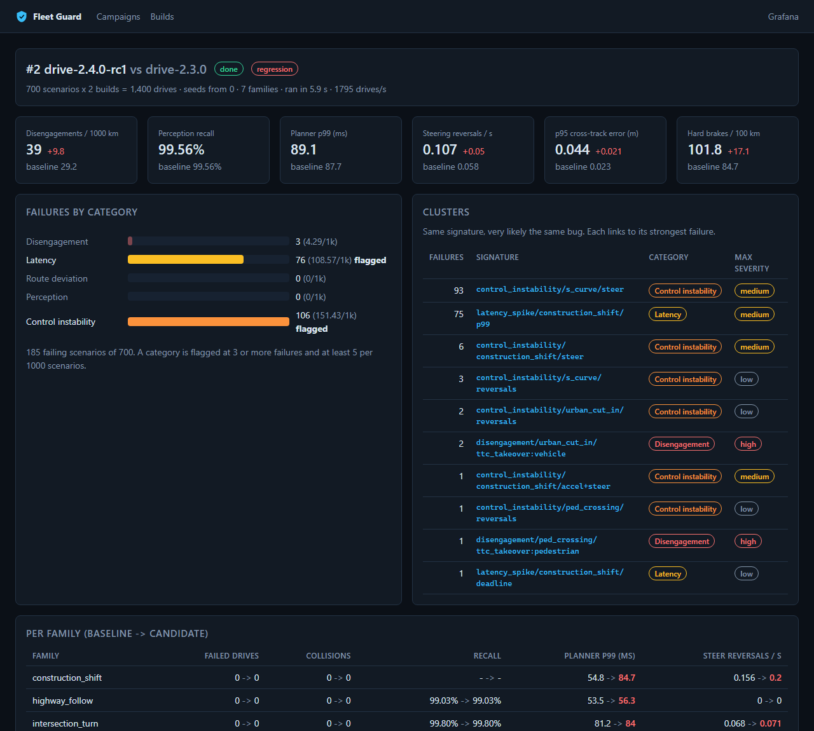
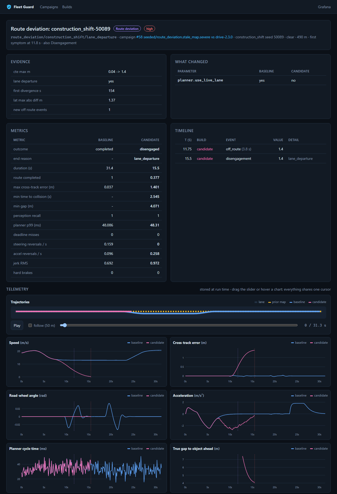
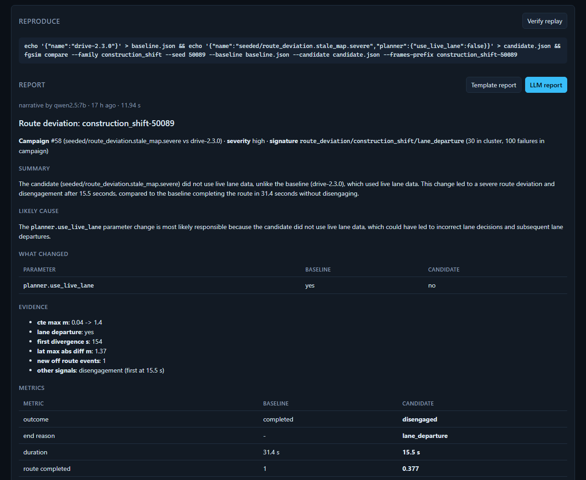

# Fleet Guard

A validation platform for autonomous-driving software builds. It replays the same
seeded driving scenarios through a known-good baseline build and a release
candidate, compares what the two did across trajectory, perception, planning and
control signals, classifies every regression it finds, and turns each cluster of
failures into a report an engineer can reproduce with one command.

```
                 +-----------------------------+
 builds/*.json ->|  fgsim (C++17)              |  scenarios x {baseline, candidate}
 scenario seeds  |  sim, perception, planner,  |  -> drives, events, pair diffs,
                 |  control, compare, batch    |     10 Hz telemetry (flagged pairs)
                 +--------------+--------------+
                                | JSONL + CSV, COPY
                 +--------------v--------------+     +-------------------+
 POST /campaigns |  Postgres                   |<----| worker (Python)   |
 ----------------|  drives, events, pairs,     |     | claim (SKIP LOCKED)|
                 |  telemetry, failures,       |     | ingest, classify, |
                 |  reports, alerts            |     | verdict, reports  |
                 +--------------+--------------+     +-------------------+
                                |
          +---------------------+----------------------+
          |                     |                      |
  +-------v-------+    +--------v--------+    +--------v--------+
  | FastAPI       |    | Prometheus      |--->| Alertmanager    |
  | /api, /metrics|<---| scrape, rules   |    | -> /api/alerts  |
  +-------+-------+    +--------+--------+    +-----------------+
          |                     |
  LLM narratives        +-------v--------+
  (Ollama, guarded)     | Grafana        |
                        +----------------+
```

## What it does

- **Scenario replay at scale.** `fgsim` drives 7 seeded scenario families
  (highway following, urban cut-ins, pedestrian crossings, S-curves,
  intersection turns, work-zone lane shifts, stop-and-go) with a kinematic
  vehicle, actuator delay and lag, a perception model (range, FOV, weather,
  misses, phantoms, tracker, latency), an IDM planner with a timing model and a
  pure-pursuit/PI controller. Every drive is deterministic in (scenario seed,
  build), and both builds share their random draws, so differences between them
  come from the build, not from luck. About 4,000 drives/s on 22 threads.
- **Build-vs-build comparison.** Drives are aligned on route arc length and
  compared on lateral offset, speed profile, time, first point of divergence and
  every summary metric.
- **Telemetry queries and failure classifiers.** SQL views over the drive tables
  (KPIs per build and per family, new candidate events) feed five SQL
  classifiers: disengagements, latency spikes, route deviations, perception
  errors and control instability. A failing scenario usually trips several; the
  root cause is the earliest signal before the takeover. Failures cluster by
  signature (category/family/key).
- **Reproducible reports.** Every failure replays bit for bit from its seed and
  the two build definitions (`fleetguard repro` checks it). Reports carry the
  evidence, metrics, event timeline, parameter diff and the repro command; an LLM
  (local Ollama by default) can write the narrative, which is checked against the
  facts before it is used.
- **Monitoring.** Prometheus metrics for fleet KPIs and the worker, alert rules
  with promtool unit tests, Alertmanager delivering to the API, and three
  provisioned Grafana dashboards.

## The triage UI

Campaigns with live progress, verdicts and the alerts Alertmanager delivered:



A campaign: baseline -> candidate KPIs, failures per category against the flag
threshold, clusters (one probable bug each) and where in the scenario set the
regression lives:



A failure: evidence, the parameter change behind it, both drives on one clock,
and the trajectory map. Here the candidate keeps following the prior map (yellow)
through a work-zone lane shift while the baseline takes the shifted lane:



Its report, with the narrative written by a local `qwen2.5:7b` and checked against
the facts, plus the command that replays the pair:



## Results

All measured, all reproducible; details and caveats in [docs/RESULTS.md](docs/RESULTS.md).

- Seeded-regression benchmark (50 injected bugs, 10 clean controls, held-out
  seeds, 84,000 drives): **37/50 reproduced**, 1/10 controls flagged.
- One 100,000-drive campaign end to end in 52 s (simulate 24 s, ingest 26 s,
  classify 2 s) on a 22-thread desktop.
- LLM narratives on a local `qwen2.5:7b`: 28/30 accepted by the guard (both
  rejections were the guard's fault, since fixed); median 13 s on a laptop GPU.
- Triage items to open (proxy, not time): 208 flagged scenarios -> 10 cluster
  reports for `drive-2.4.0-rc1`.

## Quick start

```bash
make up          # or: docker compose up -d --build
make campaign    # queue drive-2.4.0-rc1 against drive-2.3.0, 700 scenarios
make smoke       # end-to-end check over HTTP
```

UI on :8080, API docs on :8000/docs, Grafana on :3000, Prometheus on :9090,
Alertmanager on :9093. The worker picks the campaign up; 700 scenarios (1,400
drives) take a few seconds. The release story in `builds/`: rc1 regresses in
latency and control, rc2 fixes the latency, rc3 fixes the control loop and passes.

CLI equivalents:

```bash
docker compose run --rm migrate fleetguard campaign create \
    --baseline drive-2.3.0 --candidate drive-2.4.0-rc1 --count 700
docker compose run --rm migrate fleetguard campaign list
docker compose run --rm migrate fleetguard campaign show 2
```

Reports:

```bash
docker compose run --rm migrate fleetguard report <failure_id> --llm   # needs Ollama on the host
docker compose run --rm migrate fleetguard repro <failure_id>
```

Benchmark:

```bash
docker compose run --rm -v "$PWD/docs:/app/docs" migrate fleetguard benchmark --out /app/docs/benchmark
```

## Layout

| path | what |
|---|---|
| `core/` | C++17 simulator, comparison and batch runner (`fgsim`), GoogleTest suite |
| `fleetguard/` | Python: campaigns, ingestion, classifiers (`classifiers/sql/`), verdicts, repro, benchmark, diagnostics, API, worker, metrics |
| `web/` | React + TypeScript triage UI (Vite, vitest), served by nginx in compose |
| `db/migrations/` | Postgres schema and views |
| `builds/` | build definitions (`drive-2.3.0` baseline, `2.4.0` release candidates) |
| `deploy/` | Prometheus rules and tests, Alertmanager, Grafana provisioning and dashboards |
| `tools/` | dashboard generator, LLM eval, triage-effort counter, e2e smoke test, plotting |
| `docs/` | [results](docs/RESULTS.md), [architecture notes](docs/ARCHITECTURE.md), [release gate](docs/RELEASE_GATE.md), benchmark output, LLM eval and example reports |

## Development

```bash
# C++ core
docker build --target toolchain -t fleetguard-toolchain .
docker run --rm -v "$PWD:/src" fleetguard-toolchain \
  bash -c "cmake -S core -B build -G Ninja && cmake --build build && ctest --test-dir build"

# Python (needs fgsim and a Postgres for the integration tests)
pip install -e ".[dev]"
FG_FGSIM=build/fgsim FG_TEST_DATABASE_URL=postgresql://... pytest
```

```bash
# UI against a running API
cd web && npm install && npm run dev      # :5173, proxies /api to :8000
```

CI runs the core in Release and under ASan/UBSan, the Python suite against a
Postgres service, ruff, promtool on the alert rules, the UI typecheck/tests/build,
and the smoke test against a freshly built compose stack.
